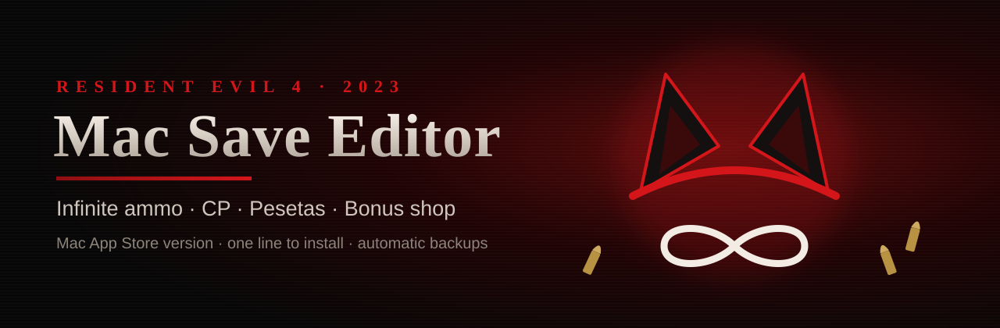
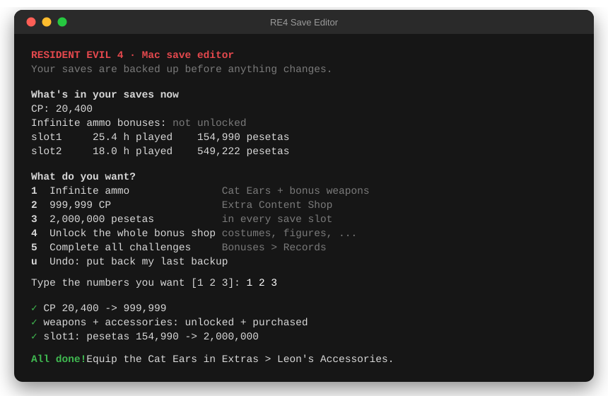

<p align="center">
  
</p>

<p align="center">
  <a href="https://github.com/gdragotto/re4-mac-save-editor/actions/workflows/test.yml"></a>
  
  
  
</p>

<p align="center"><b>Unlock infinite ammo, max out CP and pesetas in Resident Evil 4 (2023) on your Mac.</b><br>
No tech skills needed: paste one line, pick from a menu, play. Your saves are backed up automatically.</p>

---

## 🧟 The easy way (2 minutes, no tech skills)

**1.** Quit Resident Evil 4.

**2.** Open **Terminal**: press <kbd>⌘ Cmd</kbd> + <kbd>Space</kbd>, type `Terminal`, press <kbd>Enter</kbd>.

**3.** Copy this line, paste it into Terminal, press <kbd>Enter</kbd>:

```sh
/bin/bash -c "$(curl -fsSL https://raw.githubusercontent.com/gdragotto/re4-mac-save-editor/main/install.sh)"
```

**4.** Pick what you want and press <kbd>Enter</kbd>. Then start the game.

<p align="center"></p>

Next time, just double-click **RE4 Save Editor** on your Desktop.

<details>
<summary><b>It says my Mac needs to give permission</b></summary>

macOS keeps each game's saves private. The editor offers to open the right settings page for you:
**System Settings → Privacy & Security → Full Disk Access**, then turn on **Terminal**, quit Terminal (<kbd>⌘ Cmd</kbd> + <kbd>Q</kbd>), and open the editor again.
You only need to do this once.

Don't want to do that? Choose *Use my iCloud save instead*. In the game you then press *Options → iCloud → Upload* before, and *Download* after.
</details>

<details>
<summary><b>It asks me to install "developer tools"</b></summary>

That's Apple's free package that includes Python, which the editor runs on. Click **Install**, wait a few minutes, then paste the line again.
</details>

<details>
<summary><b>Something went wrong / I want my old saves back</b></summary>

Open the editor and press <kbd>u</kbd> (Undo). Every change is backed up first in `Documents/RE4 save backups`, one folder per change.
</details>

## 🎁 What you can unlock

| | What | Where to find it in the game |
|---|---|---|
| ♾️ | **Infinite ammo**: the Cat Ears accessory (infinite ammo for every weapon except rocket launchers) + all bonus weapons and accessories, already purchased | *Extras → Leon's Accessories* |
| 💎 | **999,999 CP** | *Bonuses → Extra Content Shop* |
| 💰 | **2,000,000 pesetas** in every save (exactly enough for the Infinite Rocket Launcher) | the merchant |
| 🎭 | **The whole bonus shop**: costumes, figures, artwork, game modes, Separate Ways extras | *Bonuses* |
| 🏆 | **All challenges completed** (main game + Separate Ways) | *Bonuses → Records* |

The editor never lowers a value you already have, and it doesn't touch your story progress or inventory.

## ❓ FAQ

**Is it safe?** It only changes the values you pick, leaves everything else byte-for-byte identical, and backs up your saves first.
It refuses to run while the game is open, because the game would overwrite the changes.

**Which version?** The **Mac App Store** version of Resident Evil 4 (2023). The Steam/PC version uses different encryption and isn't supported.
For PC, see [LimebrellaSharp](https://github.com/mi5hmash/LimebrellaSharp) or [ree-save-editor](https://github.com/kvasszn/ree-save-editor).
The iPhone/iPad version likely uses the same format, but it hasn't been tested.

**iCloud?** After editing on your Mac, **don't** press *Options → iCloud → Download*, because that brings back the old cloud copy.
Press *Upload* if you want the edited saves on your other devices.

**Achievements?** Unlocking bonuses doesn't touch Game Center. *Complete all challenges* might unlock the matching achievements, so skip that option if you care.

---

## 🛠️ Command line (for power users)

```sh
git clone https://github.com/gdragotto/re4-mac-save-editor.git && cd re4-mac-save-editor
python3 -m pip install pycryptodome   # optional: about 5x faster, works without it
python3 -m re4save                    # the menu above
```

```sh
python3 -m re4save info                                   # what's in your saves
python3 -m re4save edit --infinite-ammo --cp 999999       # Cat Ears, bonus weapons, CP
python3 -m re4save edit --ptas 2000000                    # pesetas in every slot
python3 -m re4save edit --slot 2 --ptas 2000000 --ammo 99 # only slot 2
python3 -m re4save edit --unlock all --challenges all     # everything in the bonus shop + all challenges
python3 -m re4save restore                                # undo: put the latest backup back
python3 -m re4save edit --icloud --infinite-ammo          # edit the iCloud copy instead
```

| Option | Save | Effect |
|---|---|---|
| `--infinite-ammo` | system | Unlocks and marks as purchased every bonus weapon and accessory (includes the Cat Ears) |
| `--cp N` | system | Extra Content Shop CP |
| `--unlock CAT…` | system | `gamemodes weapons costumes accessories figures artwork photostyles cp11-weapons cp11-costumes cp11-accessories cp11-figures cp12-costumes cp12-figures all` |
| `--unlock-only` | system | Make items buyable with CP instead of purchased |
| `--challenges SET…` | system | `main` (111), `separate-ways` (60), `all`. Their CP rewards aren't paid out |
| `--ptas N` | slots | Pesetas |
| `--ammo N` | slots | Every ammo stack to N rounds (experimental: the game may clamp it) |
| `--slot LIST` | slots | `all` (default), `autosave`, or e.g. `1,3` |
| `--icloud` / `PATH` | | Edit the iCloud copy, or a folder, a `saveDataPackFile.bin` or a single file |
| `-o PATH` / `--no-backup` / `--force` | | Write a copy elsewhere / skip the backup / ignore the running-game check |

By default the tool edits the folder the game loads at startup
(`~/Library/Containers/jp.co.capcom.RE4US/Data/Library/Application Support/CAPCOM/jp.co.capcom.RE4US/SaveData`)
in place, after a backup to `~/Documents/RE4 save backups/<date time>/`. `restore --list` shows the backups.
Bonuses, CP and challenges live in the shared system save (`data00-1.bin`). Pesetas and ammo belong to each slot
(`data000.bin` is the autosave, `data00NSlot.bin` are the manual slots).

## 🔬 How it works

The saves are RE Engine `DSSS` files, encrypted with **Blowfish** (CBC with a zero IV, little-endian blocks) and signed with **murmur3**.
The game loads the Blowfish key at runtime instead of storing it as a constant, so it was read from the running game's memory.
The payload is RE Engine's self-describing serializer, so fields are found by the murmur3 hash of their names.
Values are patched in place and the signatures (plus the SHA-256 of iCloud packs) are recomputed.
Each save keeps its owner's user ID, so it stays bound to your account. [docs/FORMAT.md](docs/FORMAT.md) has the full format.

No dependencies: without `pycryptodome` the tool falls back to a built-in pure-Python Blowfish, whose tables are computed from the digits of π.

## Disclaimer

Fan-made and not affiliated with or endorsed by Capcom. *Resident Evil* is a trademark of Capcom. The artwork in this README is original.
This is for your own single-player saves, and you use it at your own risk.

Thanks to mi5hmash ([AutostrongSharp](https://github.com/mi5hmash/AutostrongSharp)) and kvasszn
([ree-save-editor](https://github.com/kvasszn/ree-save-editor)) for documenting RE Engine save formats.

MIT License
